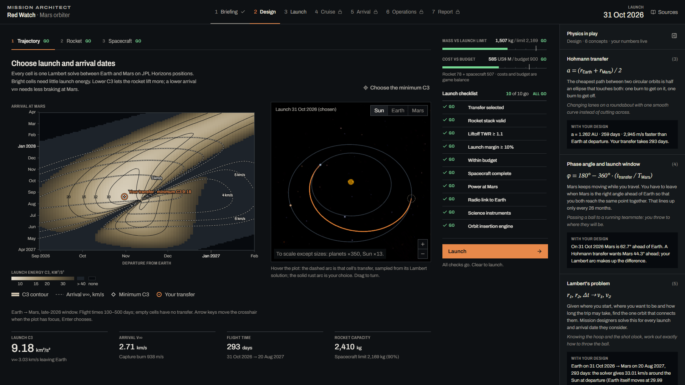
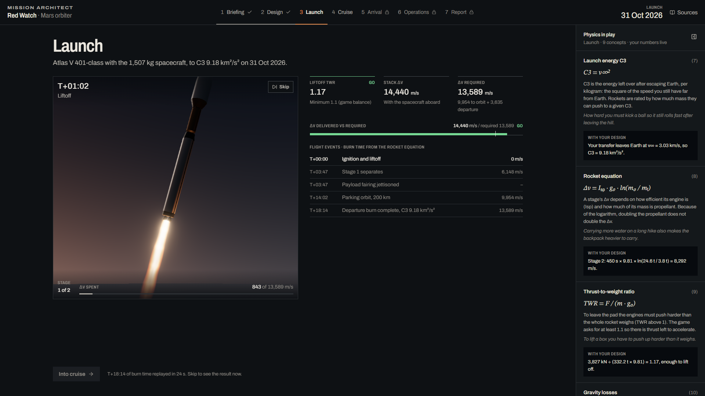
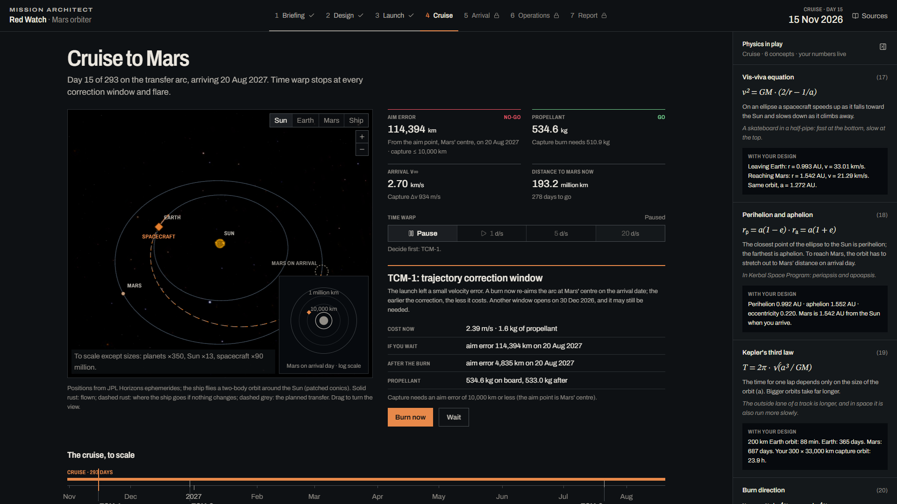
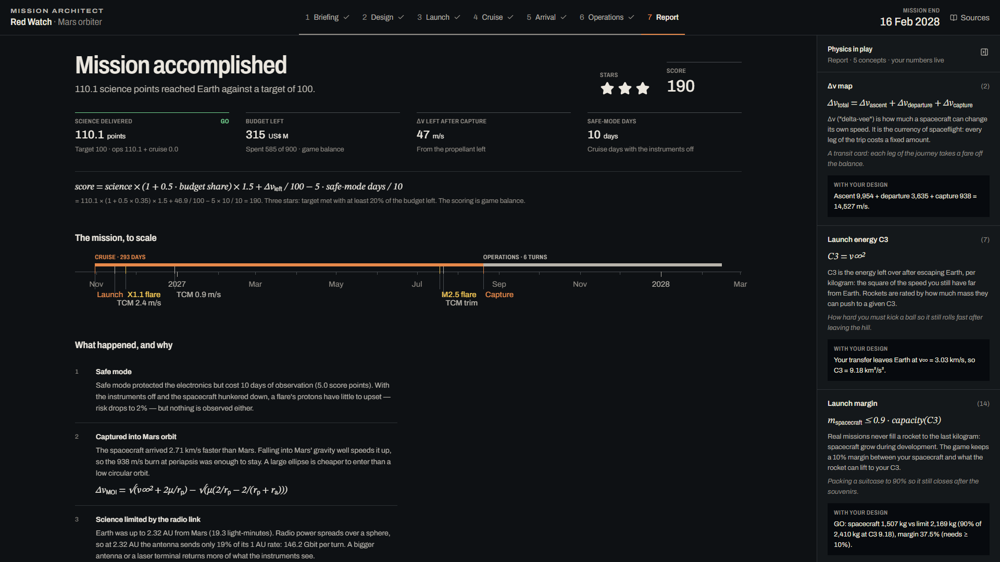

# Mission Architect

A browser game for the NASA Space Apps Challenge 2026 challenge **"Space Mission Design Game"**. You plan one Mars orbiter mission ("Red Watch") from start to finish: pick a launch date on a real porkchop plot, build a rocket that can deliver your spacecraft, design the spacecraft, launch, fly the cruise, capture into Mars orbit, run science operations, and read a report that explains every outcome with physics. Every number on screen comes from NASA data, is computed from it, or is labelled "game balance".

This branch (`vision-prototype`) is a **vision prototype**: it shows the team what a strong entry can look like. The 48-hour hackathon version will be a smaller rebuild (see [Hackathon cut-down](#hackathon-cut-down)).

| Trajectory design: porkchop plot and 3D preview | Launch of the player's own rocket |
|---|---|
|  |  |
| **Cruise: course correction decision** | **Report: score, timeline and lessons** |
|  |  |

## The core loop

Real interplanetary mission design is a feedback loop, and the game is built on it:

```
launch date (porkchop plot) ──► departure energy C3 ──► rocket capacity at that C3
            │                                                  │
            └──► arrival v∞ ──► capture propellant ──► max spacecraft wet mass ──► budget
                                                               │
                         flight decisions (TCMs, flare responses) ──► science operations ──► report
```

1. **Porkchop plot.** Each cell is a Lambert solve between Earth and Mars on JPL Horizons positions. The chosen cell fixes C3 (launch energy) and arrival v∞.
2. **Rocket.** Stack stages from real engine and tank data. Capacity to the chosen C3 comes from the rocket equation, stage by stage.
3. **Spacecraft.** Power, comms, instruments, shielding and propellant. Wet mass must stay at or below 90 % of the rocket's capacity, and total cost within the US$ 900 M cap. A launch checklist gates the Launch button.
4. **Flight.** Launch (liftoff TWR and Δv decide whether you reach the departure), cruise with trajectory correction maneuvers and real DONKI solar flares, then the capture burn at Mars.
5. **Operations.** Six 30-day turns: choose instruments within the power budget; data return falls with Earth–Mars distance.
6. **Report.** Outcome, score, stars, a timeline, lessons tied to what happened, and a comparison with MAVEN and MRO.

## Running it

Requires **Node ≥ 22.12**.

```bash
npm install
npm run dev        # Vite dev server, http://localhost:5173
npm test           # Vitest unit tests (physics, game rules, data catalogs)
npm run typecheck  # tsc, no emit
npm run build      # typecheck + production build into dist/
npm run preview    # serve the production build
```

The game makes no network calls at runtime. All data, textures and fonts are in the repo, so a demo cannot break because an API is down. `vercel.json` deploys it as a static site.

### Dev URL flags

Jump straight to any screen with the reference design and a fixed event seed, for repeatable demo shots:

```
http://localhost:5173/?phase=cruise&preset=reference&seed=1
```

- `phase`: `select`, `briefing`, `design`, `launch`, `cruise`, `arrival`, `ops`, `report`, `sources`. `cruise`, `arrival`, `ops` and `report` need `preset=reference`: the game autoplays the reference flight up to that point.
- `preset=reference`: load the reference design (Atlas V 401-class rocket, 1,507 kg spacecraft, minimum-C3 transfer).
- `seed=<int>`: fixes which flares happen and the launch injection error. Without it, every new game gets a fresh seed.

Unknown values fall back to mission select without an error.

### Refreshing the data

```bash
npm run fetch:data
```

This runs two dependency-free Node scripts:

- `scripts/fetch-horizons.mjs`: daily heliocentric state vectors of Earth and Mars (ecliptic J2000, 2026-07-01 to 2029-07-01) from the JPL Horizons API into `src/data/generated/ephemeris-{earth,mars}.json`.
- `scripts/fetch-donki.mjs`: M- and X-class solar flares of 2024 from NASA DONKI into `src/data/generated/donki-flares.json`. It tries `api.nasa.gov` first (set `NASA_API_KEY`, otherwise it uses `DEMO_KEY`), then the CCMC endpoint behind it. If both fail it exits with an error and never writes invented events.

`node scripts/fetch-donki.mjs --from-wayback` is a documented manual fallback that reads Wayback Machine snapshots of real DONKI responses. **The committed flare file was built this way**: on 2026-10-22 both live DONKI endpoints were down, so it holds three archived ~30-day DONKI windows (241 M/X flares between May and December 2024, partial-year coverage). The `source` field and the in-game Data sources screen say so.

Every data file records its source and fetch date.

## NASA data used

| Dataset | Provider | How the game uses it |
|---|---|---|
| Earth and Mars state vectors, daily, 2026–2029 (DE441 / mar099) | NASA/JPL Solar System Dynamics, Horizons System | Porkchop plot, cruise propagation, 3D solar system, Earth–Mars distance for the radio link and signal delay |
| Solar flares (M and X class), 2024 | NASA DONKI (CCMC, via archived responses) | Cruise events: each flare shows its real date and class |
| Launch vehicle payload vs. C3 curves | NASA Launch Services Program, Launch Vehicle Performance Website (Atlas V 401 curve via the open-source AMAT digitization) | Validating the preset rockets; shown as the real-world reference next to the player's rocket |
| MAVEN launch C3 and orbit-insertion Δv | NASA Technical Reports Server (NTRS 20160000802) | Anchor point for the Atlas V curve; report comparison |
| MRO and MAVEN press kits | NASA / JPL, NASA / CU LASP | Scale of spacecraft parts (arrays, antennas, recorders, propulsion); report comparison |
| HiRISE / CRISM instrument data, Mars 2020 MMRTG fact sheet, DSOC results, RS-25 fact sheet | NASA, JPL, NASA PDS | Instrument, power-source, laser-terminal and engine figures |
| Small Spacecraft State of the Art, Power | NASA Small Spacecraft Systems Virtual Institute | Solar array W/kg and battery Wh/kg |
| Blue Marble Next Generation; Viking MDIM 2.1 mosaic; Deep Star Maps; SDO/AIA 171 Å | NASA Earth Observatory; USGS / NASA; NASA Goddard SVS; NASA SDO | Earth, Mars, star-field and Sun textures |

Engine and stage figures from manufacturers (ULA, SpaceX, Northrop Grumman, L3Harris, Nammo) fill in the parts NASA does not publish. The full list, with URLs and fetch dates, is in `src/data/sources.ts` and on the in-game **Data sources** screen.

**Real vs. game balance.** Physical constants, planet positions, engine specs and launch-vehicle curves are real. Part prices, science points, flare effects, the budget, the science target, the operations turn length and the scoring formula are game balance, inspired by real orders of magnitude, and the game labels them that way.

## Physics and validation

- **Lambert solver** (single revolution, prograde, universal variables), unit-tested against Curtis, *Orbital Mechanics for Engineering Students*, Example 5.2.
- **2026 window.** The best transfer the porkchop finds is **C3 9.18 km²/s²**, departing **31 Oct 2026** and arriving **20 Aug 2027** (293 days, arrival v∞ 2.71 km/s), in line with the real late-2026 Mars window. A test checks that the minimum falls inside that window (C3 7–14 km²/s², departure Oct–Dec 2026); the exact result is listed on the Data sources screen.
- **Launch vehicles.** Capacity to a C3 is the largest payload for which the stack's Δv covers the ascent plus the departure burn (bisection). The three preset rockets with NASA LSP curves (Atlas V 401, Falcon Heavy expendable, Vulcan VC4) land within **±8 %** of every LSP point; the worst is −7.9 %.
- **Spacecraft.** Capture burn from the arrival v∞ into a 300 × 33,000 km orbit, propellant from the rocket equation; solar power ∝ 1/r²; radio data rate ∝ 1/d² with one Deep Space Network pass per day; signal delay d/c; solar-conjunction blackout.

How the game simplifies (also listed on the Data sources screen):

- Two-body patched conics, impulsive burns, single-revolution transfers, no gravity assists.
- The ascent is not flown. It costs a Δv budget of 9,400 m/s at liftoff TWR 1.5, plus a gravity-loss term 3,000 × (1/TWR − 1/1.5) m/s (game balance, calibrated against the LSP curves). Liftoff TWR must be at least 1.1.
- Course corrections aim at Mars' centre; the capture burn assumes a 300 km periapsis.
- The launch animation replays the computed result (burn times from propellant mass and mass flow). It is not a separate flight simulation.

## Tech stack

Vite 6, React 19, TypeScript 5 (strict), Tailwind CSS 4, shadcn/ui (Radix), Motion, Zustand 5, three.js with React Three Fiber 9, drei and postprocessing, d3-contour and d3-scale, Vitest. Physics (`src/physics`) and game rules (`src/game`) are framework-free TypeScript: they never import React, three.js or the DOM, so they can be tested in Node and lifted into another codebase.

## Project structure

```
scripts/            fetch-horizons.mjs, fetch-donki.mjs (data refresh, Node, no dependencies)
public/textures/    NASA planet, Sun and star textures (with SOURCES.md)
src/
  physics/          vectors, time, Kepler, Lambert, porkchop (+ Web Worker), rocket, launcher, link
  data/             catalogs (engines, tanks, boosters, presets, spacecraft parts), LSP curves,
                    mission constants, concepts, data sources; generated/*.json from the scripts
  game/             flow, checklist, cruise, events, operations, scoring, lessons, autoplay
  app/              store (Zustand), dev URL flags, mission clock
  components/       app shell, physics panel, porkchop plot, readouts, gauges, timeline
  screens/          mission select, briefing, design workspace, launch, cruise, arrival, ops,
                    report, data sources
  scenes/           React Three Fiber scenes: hangar, launch, solar system, spacecraft, Mars arrival
docs/               design spec, implementation plan, screenshots
```

Documentation:

- [Design spec](docs/superpowers/specs/2026-10-22-mission-architect-vision-design.md): intent, player journey, data, math.
- [Implementation plan](docs/superpowers/plans/2026-10-22-mission-architect-vision.md): the 17 tasks this prototype was built in.
- [DESIGN.md](DESIGN.md): visual identity and design tokens. [PRODUCT.md](PRODUCT.md): audience and product purpose.

## Hackathon cut-down

The prototype is structured so a 48-hour team version is an easy cut:

- **Keep:** the porkchop plot on pre-fetched Horizons data, the modular rocket with capacity vs. C3, spacecraft mass/power/budget design, a simple cruise with one or two DONKI events, the capture burn and the report.
- **Simplify:** rocket builder and launch can go back to 2D; the 3D becomes one solar-system scene with fewer camera moves (or 2D if time is short).
- **Drop:** the locked mission teasers, extra subsystems, the real-mission comparison.

The solver, porkchop worker, fetch scripts and data files are standalone, documented and tested modules, so the team can reuse them if the event rules allow pre-existing code, or re-type them from this reference if not.

## AI use disclosure

This prototype was built with AI assistance: Claude Code (Anthropic) agents did the design, planning, implementation and review under the team's direction. No images are AI-generated; the planet, Sun and star textures are NASA imagery, credited on the Data sources screen. The game uses no NASA logos or mission insignia; real mission names appear only in factual comparisons.
