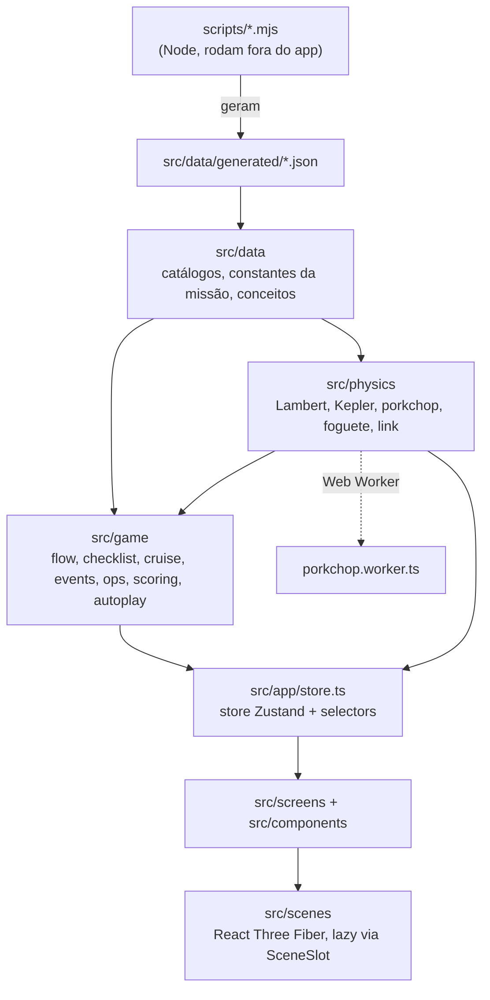
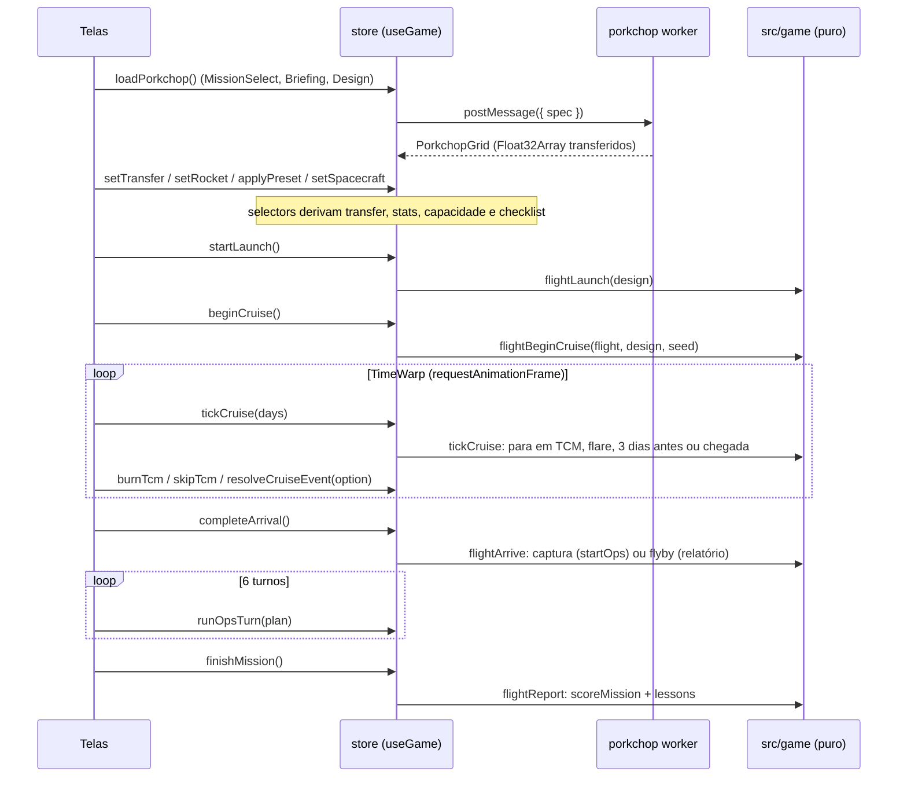
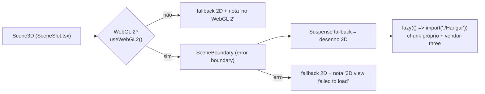

# Arquitetura

Como o código do Mission Architect está organizado e por quê. Para rodar o projeto, veja [DEVELOPMENT.md](DEVELOPMENT.md). Para a física, [PHYSICS.md](PHYSICS.md); para os dados, [DATA.md](DATA.md); para as regras do jogo, [GAMEPLAY.md](GAMEPLAY.md). O plano do corte de 48 h está em [HACKATHON.md](HACKATHON.md) e as decisões registradas em [DECISIONS.md](DECISIONS.md).

Estado descrito: branch `vision-prototype`, commit `0049ae1` (23/10/2026).

## Visão geral em camadas

O app é uma SPA Vite + React 19 sem roteador: a tela visível é o campo `phase` da store Zustand. Por baixo dela há três camadas de TypeScript puro (dados, física, regras do jogo) que não sabem que existe React.



As setas indicam "é usado por". O sentido é sempre de baixo para cima: `physics` não importa `screens`, `game` não importa a store.

Exceções que existem hoje e que você vai encontrar:

- `src/game/types.ts` guarda as interfaces dos catálogos (`EnginePart`, `TankPart`, `SpacecraftPart`...). Os arquivos de `src/data` e `src/physics/launcher.ts` importam esses tipos com `import type`. É só tipo, não cria dependência em tempo de execução.
- `src/data/concepts.ts` (os cards do painel de física) fica acima da store: importa o tipo `GameView` de `@/app/store` e helpers de `src/game`, porque cada card calcula números ao vivo com o design do jogador.
- As cenas 3D importam `formatNumber` de `src/components/status.ts`.

### A regra: física e regras do jogo não importam React, three.js nem DOM

`src/physics`, `src/game` e `src/data` são TypeScript puro. Nenhum arquivo nessas pastas importa `react`, `three`, `@react-three/*`, `zustand` ou `motion`, nem toca em `window` ou `document`. Os cabeçalhos dos módulos repetem isso ("Framework-free: no React, Three.js or DOM").

Por quê:

1. Testes rápidos e confiáveis. O Vitest roda com `environment: 'node'` (ver `vite.config.ts`); 434 testes passam em menos de 2 s, sem navegador nem GPU.
2. O mesmo código roda no Web Worker. `porkchop.worker.ts` importa `porkchop.ts`, que importa `ephemeris.ts` e `lambert.ts`. Um worker não tem DOM.
3. Determinismo. As transições do voo são funções puras sobre um `FlightState`; com a mesma seed e as mesmas escolhas, o resultado é idêntico. É isso que permite o autoplay das flags de dev.
4. Reaproveitamento no hackathon. Solver, porkchop, catálogos e regras podem ser copiados (ou redigitados) para outro projeto sem arrastar a UI.

Quando precisar de algo visual a partir da física (posição de peça 3D, escala do sistema solar, timing da animação), escreva um helper puro em `src/scenes/*.ts` ou `src/components/*.ts` e deixe o `.tsx` só desenhar. Exemplos: `rocketLayout.ts`, `launchTiming.ts`, `solarScale.ts`, `porkchopScale.ts`.

## Pastas e módulos

### `src/physics`: mecânica orbital e foguetes

Unidades SI, tempo em Julian Date. Cada arquivo tem um `.test.ts` ao lado.

| Módulo | Responsabilidade |
|---|---|
| `constants.ts` | `G0`, `AU`, `C`, `DAY`, `MU_SUN`, `MU_EARTH`, `MU_MARS`, `R_EARTH`, `R_MARS`, `SOI_MARS` |
| `time.ts` | Julian Date: `jdFromIso`, `jdFromDate`, `dateFromJd`, `formatJd`. TDB é tratado como UTC (ignora ~69 s) |
| `vec.ts` | Vetores 3D como tuplas (`Vec3`, `StateVector`), sem mutação |
| `ephemeris.ts` | `bodyState(body, jd)`: estado heliocêntrico de Terra ou Marte por interpolação cúbica de Hermite dos vetores diários do Horizons. Fora de `EPHEMERIS_RANGE` lança `RangeError` |
| `kepler.ts` | Propagação de dois corpos com variáveis universais (Curtis, Alg. 3.3/3.4): `propagate`, `sampleTrajectory` |
| `lambert.ts` | `lambert(r1, r2, tof, mu)`: uma revolução, prógrado (Curtis, Alg. 5.2) |
| `orbit.ts` | Relações fechadas: `circularSpeed`, `visViva`, `period`, `hohmann`, `escapeBurn`, `captureBurn`, `orbitalElements` |
| `rocket.ts` | Equação de Tsiolkovsky: `deltaV`, `propellantFor`, `propellantFromMass` |
| `launcher.ts` | Foguete modular: `rocketStats` (Δv, TWR, massa e custo por estágio), `capacityToC3` (bisseção), `launchTimeline` (eventos do lançamento), limites (`MAX_STAGES`, `MIN_LIFTOFF_TWR`...) |
| `link.ts` | `solarPowerW` (∝ 1/r²), `dataRateMbps` (∝ 1/d²), `signalDelayS`, `solarConjunction`, `dataVolumeGb` |
| `porkchop.ts` | `DEFAULT_PORKCHOP` (janela de 2026), `transferFor(depJd, arrJd)` e `computePorkchop(spec)` |
| `porkchop.worker.ts` | Entrada do Web Worker que roda `computePorkchop` |
| `porkchopClient.ts` | `computePorkchopAsync()`: cria o worker, devolve uma Promise |

### `src/data`: catálogos e constantes

| Módulo | Responsabilidade |
|---|---|
| `generated/ephemeris-earth.json`, `generated/ephemeris-mars.json` | Vetores diários do JPL Horizons (km, km/s), 2026-07-01 a 2029-07-01. Escritos por `scripts/fetch-horizons.mjs` |
| `generated/donki-flares.json` | Flares M/X do NASA DONKI de 2024 (três janelas arquivadas). Escrito por `scripts/fetch-donki.mjs` |
| `donki.ts` | Acesso tipado aos flares, `DONKI_META` com as janelas de cobertura reais |
| `engines.ts`, `tanks.ts`, `boosters.ts` | Peças do foguete com fonte por item (`source`) |
| `presets.ts`, `presetReference.ts`, `lsp.ts` | Foguetes prontos montados só com peças do catálogo, números reais dos veículos e curvas NASA LSP para validar |
| `spacecraftParts.ts` | Peças da sonda (bus, energia, comunicação, instrumentos, proteção, armazenamento, propulsão) |
| `mission.ts` | `MISSION` (a missão "Red Watch": orçamento, órbita de captura, turnos...) e o modelo de Δv de subida (`ASCENT_DV`, `GRAVITY_LOSS_K`...) |
| `concepts.ts` | Os 27 cards do painel de física: fórmula, ideia, analogia, fases e `live(view)` com os números do jogador; também `SIMPLIFICATIONS` |
| `realMissions.ts` | MAVEN e MRO para a comparação do relatório |
| `sources.ts` | Todas as fontes externas, com data de acesso (tela Data sources) |

### `src/game`: regras do jogo

| Módulo | Responsabilidade |
|---|---|
| `types.ts` | Interfaces compartilhadas dos catálogos |
| `flow.ts` | Máquina de fases: `Phase`, `PHASES`, `nextPhase`, `canEnter` |
| `checklist.ts` | `launchChecklist(design)`: os 10 itens de go/no-go (trajectory, rocket-valid, twr, margin, budget, spacecraft, power, comms, instruments, propulsion), `canLaunch`, `REFERENCE_DESIGN` |
| `spacecraft.ts` | `analyseSpacecraft`/`spacecraftStats`: massa, propelente de captura, energia em Marte, link, armazenamento, ciência, custo. `REFERENCE_SPACECRAFT` |
| `cruise.ts` | Voo Terra → Marte: `startCruise` (Lambert + erro de injeção sorteado), `advanceCruise`, janelas de TCM, `applyTcm`, `arrive` (captura ou flyby) |
| `events.ts` | Flares solares no cruzeiro: `EVENT_RULES` (game balance), `scheduleEvents`, `eventOptions`, `resolveEvent` |
| `ops.ts` | Operações científicas em órbita: `startOps`, `runOpsTurn`, `opsPlanLimits` |
| `scoring.ts` | `scoreMission`, `failureFromLaunch`, `dvLeftMs` |
| `lessons.ts` | Lições do relatório ligadas ao que aconteceu na missão |
| `rng.ts` | `createRng(seed)`: mulberry32, para todo evento aleatório |
| `autoplay.ts` | O voo inteiro como transições puras sobre `FlightState` (`flightLaunch`, `flightBeginCruise`, `tickCruise`, `burnTcm`, `answerEvent`, `flightArrive`, `flightOpsTurn`, `flightReport`) e `autoplay()`, que encadeia tudo com escolhas padrão |

### `src/app`: estado e entrada

| Módulo | Responsabilidade |
|---|---|
| `main.tsx` | Monta o React no `#root`, carrega fontes e `globals.css` |
| `App.tsx` | `MotionConfig reducedMotion="user"`, `TooltipProvider` e `AppShell`; escolhe a tela pelo `phase` |
| `store.ts` | A store `useGame`, as ações, os selectors e os hooks `use*` (detalhes abaixo) |
| `devParams.ts` | Lê as flags `?phase=&preset=&seed=` (função pura) e monta o estado inicial |
| `missionClock.ts` | Data e rótulo do relógio da barra superior em cada fase |

### `src/components`: peças de UI reutilizáveis

`AppShell` (barra superior, estações das fases, painel de física acoplado), `PhysicsPanel`, `PorkchopPlot` + `PorkchopOverlay` + `PorkchopLegend` (geometria pura em `porkchopScale.ts`), `Readout`, `Gauge`, `Checklist`, `Timeline`, `TimeWarp`, `DecisionCard`, `ActionButton`, `ConfirmDialog`, `RollingText`. `status.ts` tem `STATUS_WORD` e `formatNumber`. `ui/` são os primitivos shadcn/Radix (button, dialog, tabs, slider...). As specs visuais de cada componente estão no [DESIGN.md](../DESIGN.md#components).

Os componentes de dados (`Readout`, `Gauge`, `Checklist`, `Timeline`) recebem números prontos por props e nunca leem a store.

### `src/screens`: uma tela por fase

| Tela | Fase |
|---|---|
| `MissionSelect.tsx` | `select`: Marte jogável; Europa e asteroide aparecem bloqueados |
| `Briefing.tsx` | `briefing` |
| `design/DesignWorkspace.tsx` | `design`: abas `TrajectoryTab`, `RocketTab` (com `StageEditor`, `PresetPicker`, `StackElevation`), `SpacecraftTab`. Edições puras em `rocketEdit.ts` e `spacecraftEdit.ts` |
| `Launch.tsx` | `launch` |
| `Cruise.tsx` | `cruise` (mapa 2D em `flight/CruiseMap.tsx`) |
| `Arrival.tsx` | `arrival` |
| `Ops.tsx` | `ops` |
| `Report.tsx` | `report` |
| `Sources.tsx` | `sources`, tela lateral acessível de qualquer fase |

`flight/plate.tsx` é a moldura comum das telas de voo (inclusive o estado vazio `NoFlight`); `flight/vehicle.ts` nomeia a classe do foguete.

### `src/scenes`: 3D com React Three Fiber

| Arquivo | O que faz |
|---|---|
| `SceneSlot.tsx` | Pontos de montagem lazy das cenas, com fallback 2D (ver [Cenas 3D](#cenas-3d)) |
| `Hangar.tsx` | Foguete do jogador no hangar (aba Rocket) |
| `LaunchScene.tsx` + `launchSet.tsx`, `Exhaust.tsx` | Lançamento; timing puro em `launchTiming.ts` |
| `SolarSystem.tsx` + `Planet.tsx`, `OrbitLine.tsx`, `TransferArc.tsx`, `Starfield.tsx` | Sistema solar interno (prévia da trajetória e cruzeiro); escala pura em `solarScale.ts` |
| `SpacecraftView.tsx` + `SpacecraftModel.tsx` | Sonda girando (aba Spacecraft); layout puro em `spacecraftLayout.ts` |
| `MarsArrival.tsx` | Inserção em órbita de Marte; geometria pura em `approachGeometry.ts` |
| `RocketModel.tsx` | Malhas do foguete a partir de `rocketLayout.ts` |
| `labels.tsx`, `labelPlace.ts` | Rótulos DOM sobre o canvas, escritos por ref |
| `structures.ts` | Torre e pórtico como geometrias únicas mescladas |
| `webgl.ts` | `hasWebGL2()`: detecta WebGL 2 uma vez (código do bundle principal, sem three.js) |
| `threeSetup.ts`, `angleLog.ts` | Filtram dois avisos conhecidos do console do three.js |
| `sceneHooks.ts` | `useOnScreen`, `InvalidateOn`, easing, `devStat` |
| `DevStats.tsx` | Só em dev: draw calls, triângulos e fps em `window.__scene3d[name]` |
| `wheel.ts` | Normalização de roda e pinça para zoom |

### `src/lib`

`utils.ts` (`cn`), `clickGuard.ts` (botão ignora o segundo clique de um duplo clique por 400 ms), `useSettled.ts` (valor que só muda depois de parar de mudar; usado na região `aria-live` do relógio), `slug.ts`.

### `scripts/`

`fetch-horizons.mjs` e `fetch-donki.mjs`: scripts Node sem dependências que baixam os dados e escrevem em `src/data/generated/`. O app nunca acessa rede em tempo de execução. Uso em [DEVELOPMENT.md](DEVELOPMENT.md#atualizar-os-dados).

## Fluxo de dados de uma missão



Passo a passo:

1. Design. `MissionSelect`, `Briefing` e o design chamam `loadPorkchop()` cedo, para a grade estar pronta quando o jogador abrir a aba Trajectory. Um clique no porkchop chama `setTransfer({ depJd, arrJd })`; o resto (C3, v∞, energia em Marte, capacidade do foguete, checklist) é derivado.
2. Lançamento. `startLaunch()` só funciona com o checklist todo GO, ou com `{ override: true }` quando os únicos itens NO-GO são `twr` e `margin` ("Launch anyway"). `flightLaunch` roda `launchTimeline` com a massa úmida da sonda até o C3 da transferência. Um lançamento que falha já calcula o relatório.
3. Cruzeiro. `beginCruise()` cria o `CruiseProgress` a partir da transferência de Lambert mais o erro de injeção sorteado pela seed. O `TimeWarp` chama `tickCruise(days)` a cada frame (1, 5 ou 20 dias por segundo). O tempo para exatamente em cada janela de TCM, em cada flare, 3 dias antes da chegada e na chegada. Enquanto houver decisão pendente (`pendingDecision`), o tempo não anda.
4. Chegada. `completeArrival()` faz a queima de captura. Capturou: abre operações. Flyby: o voo termina e o relatório é calculado.
5. Operações. `runOpsTurn(plan)` roda um turno de 30 dias; são `MISSION.opsTurns` (6) turnos.
6. Relatório. `finishMission()` calcula pontuação e lições (se ainda não existirem) e abre o relatório.

Editar o design depois do lançamento descarta o voo (`scrubFlight` na store), porque ele não corresponde mais à sonda que voou. `reviseDesign()` volta ao design mantendo design e seed. `reset()` começa um jogo novo (incrementa `epoch`) e mantém a grade do porkchop, que não depende do design.

## A store Zustand

Arquivo: `src/app/store.ts`. Uma store só, `useGame`.

### Estado guardado

| Campo | O que é |
|---|---|
| `phase` | Tela atual |
| `design` | `MissionDesign`: `transfer` (`{ depJd, arrJd }` ou null), `rocket`, `spacecraft` |
| `seed` | Seed de todos os eventos aleatórios |
| `porkchop`, `porkchopStatus` | Grade calculada e `'idle' \| 'loading' \| 'ready' \| 'error'` |
| `hoverTransfer` | Célula do porkchop sob o ponteiro (prévia, não faz parte do design) |
| `designTab` | Aba do design lembrada entre telas (estado de UI) |
| `epoch` | Contador de jogos novos |
| `launched`, `arrived`, `opsDone` | Marcos do voo |
| `launch`, `cruise`, `arrival`, `ops`, `result` | O voo; null até acontecer |

### Valores derivados: nunca guardados

Tudo que é calculado a partir do design é derivado na leitura, nunca salvo na store. Assim uma edição em qualquer parte do design aparece em todo lugar ao mesmo tempo, e não existe cache para ficar desatualizado.

Há duas formas de cada derivado:

- Selectors puros, usáveis fora do React e nos testes: `selectTransfer`, `selectSpacecraftStats`, `selectRocketStats`, `selectChecklist`, `selectCanLaunch`, `selectCapacityKg`, `selectLaunchOverride`, `buildGameView`.
- Hooks para componentes: `useTransfer`, `useSpacecraftStats`, `useRocketStats`, `useChecklist`, `useCanLaunch`, `useCapacityKg`, `useGameView`.

Os hooks leem só `design` e recalculam com `useMemo` quando a referência de `design` muda. Isso funciona porque as ações nunca mutam o design: sempre o substituem por um objeto novo (`copyRocket`, `copySpacecraft`). Referência nova significa exatamente "algo mudou".

As contas caras têm memo próprio, chaveado por valor ou identidade, nunca pelo estado:

| Memo | Chave | Por quê |
|---|---|---|
| `memoTransfer` (Map, até 256) | datas + limites de TOF | Uma solução de Lambert; datas iguais devolvem o mesmo objeto (referência estável para o React) |
| `checklistMemo` (WeakMap) | objeto `design` | Vários componentes leem o checklist; avalia uma vez por design |
| `capacityKgFor` (WeakMap + Map, até 64 por foguete) | objeto `rocket` + C3 | `capacityToC3` faz ~18 passos de bisseção |

`useGameView()` junta estado e derivados para o painel de física. Ele deixa de fora `hoverTransfer`, `designTab` e o voo: o cruzeiro muda a cada frame em time warp e o painel re-renderizaria junto.

### Selectors não podem devolver objetos novos

O Zustand 5 usa `useSyncExternalStore` e compara o retorno do selector com `Object.is`. Um selector que monta um objeto ou array novo a cada chamada nunca devolve "o mesmo valor". No mínimo o componente re-renderiza a cada mudança da store (inclusive a cada frame do cruzeiro). No pior caso o React 19 entra em loop e quebra com "Maximum update depth exceeded" / "The result of getSnapshot should be cached".

O mesmo vale para derivar dentro do selector: `useGame(s => launchChecklist(s.design))` cria um array novo em toda leitura.

O que fazer:

```ts
// Um selector por campo (retorna valores já guardados na store)
const phase = useGame((s) => s.phase)
const startLaunch = useGame((s) => s.startLaunch)

// Derivados: os hooks prontos
const checklist = useChecklist()
const transfer = useTransfer()

// Se precisar de vários campos num objeto: useShallow (como useGameView faz)
const view = useGame(useShallow((s) => ({ phase: s.phase, seed: s.seed })))
```

Hoje há 90 chamadas `useGame(` nos `.tsx` e nenhuma devolve um objeto ou array literal.

## Flags de dev e autoplay determinístico

`?phase=<fase>&preset=reference&seed=<int>` abre direto numa tela com estado real. Valores aceitos e fallbacks estão em [DEVELOPMENT.md](DEVELOPMENT.md#flags-de-url-para-dev).

Como funciona:

1. `store.ts` lê `window.location.search` uma vez, ao criar a store. `parseDevParams` (puro) valida cada campo separadamente.
2. `devStartState` monta o snapshot. Com `preset=reference`, carrega uma cópia de `REFERENCE_DESIGN` e marca as fases anteriores como feitas (cruise e arrival: lançado; ops: lançado e chegou; report: tudo). Se `canEnter` recusar a fase, cai em `select`.
3. `gameData` chama `autoplay(design, seed, phase)` quando a fase pede um voo já lançado. O autoplay usa as mesmas transições puras que a store usa quando o jogador decide, com escolhas padrão:
   - queima toda TCM que a nave puder pagar;
   - responde cada flare com safe mode se possível, senão shield attitude, senão keep observing;
   - em operações, liga cada instrumento disponível que ainda cabe na energia, na ordem do catálogo.
4. Se o voo falhar no caminho, o autoplay para ali e `phase` vira a tela que mostra a falha (launch ou arrival).

Determinismo: os eventos usam `createRng` (mulberry32). Cada flare tem seu próprio stream, `eventRng(seed, event)`, derivado da seed e do id do evento por FNV-1a, então o resultado de um flare não depende da ordem em que as decisões foram tomadas. `autoplay.test.ts` verifica que a mesma seed dá o mesmo voo e seeds diferentes dão voos diferentes.

## O Web Worker do porkchop

A grade padrão (`DEFAULT_PORKCHOP`) cobre partidas de 2026-09-01 a 2027-01-31 a cada 2 dias e chegadas de 2027-04-01 a 2028-03-31 a cada 3 dias, com TOF entre 100 e 500 dias: 77 × 122 = 9.394 células, cada uma uma solução de Lambert. Isso roda fora da thread principal.

- `porkchopClient.ts` cria um worker de vida curta por chamada com `new Worker(new URL('./porkchop.worker.ts', import.meta.url), { type: 'module' })`. O Vite reconhece esse padrão e gera um bundle separado para o worker.
- O worker recebe `{ spec }`, chama `computePorkchop` e devolve a grade transferindo os buffers dos dois `Float32Array` (`c3` e `vInf`), sem cópia. Células sem transferência são `NaN`.
- Erro no worker (`error` ou `messageerror`) rejeita a Promise e termina o worker.
- A store deduplica: com `'loading'`, uma segunda chamada recebe a mesma Promise; com `'ready'`, nada é recalculado. Cada pedido tem um id; um resultado que chega depois de `clearPorkchop()` é ignorado. Com `'error'`, a aba Trajectory mostra "Compute again".
- `transferFor` e `computePorkchop` usam a mesma função interna (`solveTransfer`), então a célula do gráfico e a transferência escolhida são idênticas bit a bit.
- O worker é tipado por `tsconfig.worker.json` (lib `WebWorker`, sem DOM) e excluído de `tsconfig.app.json`.
- Nos testes, `store.test.ts` faz `vi.mock('@/physics/porkchopClient')`; o Node não tem `Worker`.

## Cenas 3D

### Carregamento: `SceneSlot`, Suspense e fallback 2D

As telas nunca importam uma cena diretamente. Elas usam os slots de `src/scenes/SceneSlot.tsx` (`HangarView`, `LaunchView`, `SolarSystemView`, `SpacecraftModelView`, `MarsArrivalView`) e passam um desenho 2D como `fallback`.



- Cada cena é `lazy(() => import('./X'))`. three.js, React Three Fiber, drei e postprocessing só chegam com a primeira vista 3D.
- Enquanto o chunk e as texturas carregam, o 2D aparece sem nota.
- Sem WebGL 2 (`hasWebGL2()` testa uma vez, com um contexto descartável que é liberado na hora), o 2D fica e uma nota diz o motivo.
- Se a cena lançar erro, a `SceneBoundary` troca pelo 2D com a nota "3D view failed to load".
- Os fallbacks são telas de verdade, não placeholders: `StackElevation` (foguete em escala, mesmo `rocketLayout` do 3D), `CruiseMap` (sistema solar 2D), o esboço da sonda e as cônicas 2D da chegada.

### Desenhar só quando precisa

| Cena | `frameloop` |
|---|---|
| `Hangar` | `'demand'` sempre: desenha só quando algo muda ou o jogador gira a câmera |
| `SpacecraftView`, `SolarSystem`, `MarsArrival` | `'demand'` na tela, `'never'` fora dela (`useOnScreen`) |
| `LaunchScene` | `'always'` enquanto a animação toca e está visível; `'demand'` caso contrário |

`useOnScreen` combina um `IntersectionObserver` (limiar 0,01) com `visibilitychange`: uma cena rolada para fora da vista ou numa aba oculta para de desenhar. `InvalidateOn` pede um frame quando ela volta.

### Memória e alocação

- Geometrias, materiais e texturas criados em `useMemo` são liberados no cleanup de um `useEffect` (`geometry.dispose()`, `material.dispose()`, `map?.dispose()`). `RocketModel.tsx` tem um `useDispose` para isso.
- Nada aloca por frame: vetores de rascunho reaproveitados, buffers pré-alocados reescritos no lugar (`TransferArc.tsx`), rótulos DOM movidos por ref sem re-render do React (`labels.tsx`).

### SMAA em vez de MSAA

`LaunchScene`, `SolarSystem` e `MarsArrival` usam `EffectComposer` com Bloom e ToneMapping. Os três criam o canvas com `antialias: false` e montam `<EffectComposer multisampling={0}>` com `<SMAA />` no fim.

Motivo: com os render targets multiamostrados do composer (MSAA), essas cenas renderizavam tudo preto em GPUs com Direct3D 11 (o ANGLE do Chrome/Edge no Windows), embora a cena em si desenhasse certo. O problema apareceu primeiro no lançamento (commit `8a87aab`) e a correção foi estendida ao sistema solar e à chegada em `0049ae1`. Não volte a `multisampling` > 0 sem testar numa máquina Windows com GPU.

`Hangar` e `SpacecraftView` não usam composer e ficam com `antialias: true` (MSAA nativo do canvas), que não tem esse problema.

`threeSetup.ts` (importado por todas as cenas) redireciona o console do three.js e descarta só dois avisos conhecidos: a depreciação de `THREE.Clock` que o R3F 9 dispara e as notas de precisão X4122 do compilador de shader do ANGLE (`angleLog.ts`). Todo o resto chega ao console normalmente.

## Chunks do build

`vite.config.ts` define `manualChunks` com a função `chunkOf`:

| Chunk | Conteúdo |
|---|---|
| `data-ephemeris` | `src/data/generated/ephemeris-*` |
| `data-events` | o resto de `src/data/generated/` (flares DONKI) |
| `vendor-three` | `node_modules/three` (lazy) |
| `vendor-react` | react, react-dom, scheduler |
| `vendor-motion` | motion, motion-dom, motion-utils, framer-motion |
| `vendor-ui` | radix-ui, lucide-react, cn, class-variance-authority, clsx, tailwind-merge, d3-*, internmap |
| (sem regra) | o código do app vai para o chunk de entrada; os bindings 3D se dividem junto com as cenas |

`chunkSizeWarningLimit` é 800 kB porque o three.js é um único módulo ES de ~770 kB que não dá para dividir. Ele só carrega com a primeira vista 3D. Os imports não mudam: Node e Vitest leem os mesmos módulos.

Tamanhos de `npm run build` em 23/10/2026 (os hashes nos nomes mudam a cada build):

Carregados na primeira tela (`index.html` faz preload de todos):

| Arquivo | Tamanho | gzip |
|---|---:|---:|
| `index-*.js` (entrada, código do app) | 282,29 kB | 95,62 kB |
| `data-ephemeris-*.js` | 248,38 kB | 120,35 kB |
| `vendor-react-*.js` | 223,69 kB | 69,45 kB |
| `vendor-motion-*.js` | 143,19 kB | 48,02 kB |
| `vendor-ui-*.js` | 117,68 kB | 40,49 kB |
| `data-events-*.js` | 43,44 kB | 5,05 kB |
| `index-*.css` | 75,20 kB | 17,02 kB |
| Total JS | 1.058,67 kB | 378,98 kB |

Mais as fontes `.woff2` (Archivo e STIX Two, por subconjunto de alfabeto).

Lazy (primeira vista 3D):

| Arquivo | Tamanho | gzip | O que é |
|---|---:|---:|---|
| `vendor-three-*.js` | 768,43 kB | 198,49 kB | three.js |
| `threeSetup-*.js` | 181,40 kB | 57,71 kB | runtime do React Three Fiber (o Rollup deu ao chunk compartilhado o nome de um módulo dele) |
| `index-*.js` (o segundo) | 180,77 kB | 82,53 kB | postprocessing (`EffectComposer`, Bloom, SMAA), compartilhado por Launch, SolarSystem e MarsArrival |
| `Lightformer-*.js` | 56,11 kB | 20,14 kB | drei `Environment`/`Lightformer` (hangar) |
| `Hangar-*.js` | 37,08 kB | 11,85 kB | |
| `LaunchScene-*.js` | 22,40 kB | 8,69 kB | |
| `SolarSystem-*.js` | 17,93 kB | 7,40 kB | |
| `OrbitControls-*.js` | 15,63 kB | 4,81 kB | |
| `MarsArrival-*.js` | 12,34 kB | 5,38 kB | |
| `SpacecraftModel-*.js` | 11,10 kB | 4,37 kB | |
| `TransferArc-*.js` | 8,87 kB | 3,91 kB | |
| `structures-*.js` | 8,19 kB | 3,21 kB | |
| `SpacecraftView-*.js` | 2,67 kB | 1,33 kB | |

O worker sai em `porkchop.worker-*.js` (252,86 kB). Ele tem a própria cópia das efemérides, porque o worker é um bundle independente.

## Estratégia de testes

- Vitest, `environment: 'node'`, `include: ['src/**/*.test.ts']`. Na HEAD: 41 arquivos, 434 testes, ~1,7 s.
- Testes ficam ao lado do módulo (`lambert.ts` → `lambert.test.ts`). Só `.ts`: não há testes de componente `.tsx`. Por isso a lógica testável das telas e cenas é extraída para módulos puros (`porkchopScale.ts`, `rocketEdit.ts`, `spacecraftEdit.ts`, `rocketLayout.ts`, `launchTiming.ts`, `solarScale.ts`, `approachGeometry.ts`, `labelPlace.ts`, `clickGuard.ts`...).
- Validação contra fontes reais, não só "o código faz o que faz":
  - `lambert.test.ts`: Curtis, Exemplo 5.2;
  - `porkchop.test.ts`: mínimos de C3 e v∞ da janela de 2026 contra o *Interplanetary Mission Design Handbook* da NASA (NASA/TM-2010-216764);
  - `launcher.test.ts`: presets contra as curvas NASA LSP de carga útil vs C3 (±15 %);
  - `catalog.test.ts`: fonte em todo item, ids únicos, números finitos, cobertura do DONKI.
- `store.test.ts` testa ações, selectors e memos, e joga a missão de referência do início ao fim pelas ações. `autoplay.test.ts` testa determinismo e as paradas do cruzeiro.
- Durante o desenvolvimento a UI e as cenas 3D foram verificadas com passeios em navegador headless (GPU real e SwiftShader), lendo `window.__scene3d` exposto por `DevStats` em modo dev. Esses scripts ficam fora do repositório; não há teste E2E no projeto.
